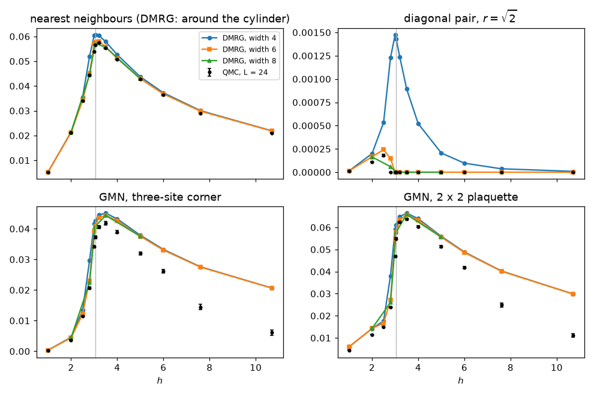

# dmrg-from-scratch

*Why I built this.* I made these tutorials for my own learning. I have been around DMRG for years: I know what a matrix product state is and roughly what infinite DMRG does, and I have run the standard packages. But running a package is not the same as understanding it. I wanted two things: to understand the algorithm at a high level, well enough to know why it works and when it fails, and to use it to understand materials and molecules. So I first wrote it myself, one small piece at a time, on a model I know well, checking each step against the exact answer. Then I took it, step by step, to the problems DMRG is used for: molecules, two-dimensional magnets and electrons, dynamics and temperature, and the question of when a quantum computer would do better.

The density-matrix renormalization group (DMRG), written from scratch in short, readable NumPy and SciPy on the transverse-field Ising chain $H = -\sum_i X_iX_{i+1} - h\sum_i Z_i$, then used through [TeNPy](https://github.com/tenpy/tenpy) and [block2](https://github.com/block-hczhai/block2-preview) on molecules, cylinders and the Hubbard model. Every result is checked against an exact answer: free fermions for the Ising chain, exact diagonalization for small clusters and molecules, or published benchmarks.

```python
import dmrg_from_scratch as dmrg

r = dmrg.dmrg(dmrg.tfim_mpo(L=100, h=1.0), chi_max=32)   # 100 spins at the critical point
r["energy"] - dmrg.tfim_open_energy(100, 1.0)              # 9e-11: error against the exact free-fermion energy
```

New to DMRG? Start with [`00_start_here`](examples/00_start_here.ipynb): why a laptop can find the ground state of 60 interacting spins (the exponential wall, the area law). Already know how DMRG works, for example from the [pocket course](docs/pocket-course.html)? Start at part 2.

**Part 1. How DMRG works**, built from scratch on the Ising chain.

| Step | What you learn | Notebook |
|---|---|---|
| 1 | Matrix product states: one SVD per cut, canonical forms, Schmidt values, truncation | [`01_mps_basics`](examples/01_mps_basics.ipynb) |
| 2 | The Hamiltonian as a matrix product operator (a 3-state machine); exact free-fermion energies | [`02_tfim_mpo`](examples/02_tfim_mpo.ipynb) |
| 3 | Finite two-site DMRG with a Lanczos eigensolver | [`03_finite_dmrg`](examples/03_finite_dmrg.ipynb) |
| 4 | Infinite DMRG, correlation length and finite-entanglement scaling | [`04_idmrg`](examples/04_idmrg.ipynb) |

**Part 2. DMRG in practice**, with well-optimized packages.

| Step | What you learn | Notebook |
|---|---|---|
| 5 | TeNPy: the same objects by their package names, what to check before trusting a result, symmetries | [`05_dmrg_in_practice`](examples/05_dmrg_in_practice.ipynb) |
| 6 | Molecules with block2: molecules as DMRG chains, breaking the N₂ bond where CCSD(T) fails, orbital order and orbital entanglement (phone companion: [quantum chemistry pocket course](docs/qchem-pocket-course.html)) | [`06_quantum_chemistry_block2`](examples/06_quantum_chemistry_block2.ipynb) |

**Part 3. Towards materials**: what experiments measure, and systems that are not chains.

| Step | What you learn | Notebook |
|---|---|---|
| 7 | Beyond the ground state: excited states by DMRG with a penalty, real-time TEBD, a quench and the entanglement barrier, the dynamical structure factor $S^{zz}(k,\omega)$ against free fermions | [`07_excitations_and_dynamics`](examples/07_excitations_and_dynamics.ipynb) |
| 8 | Finite temperature: purification with ancillas, cooling by imaginary-time TEBD, energy and specific heat at all temperatures, how much entanglement a thermal state needs | [`08_finite_temperature`](examples/08_finite_temperature.ipynb) |
| 9 | Electrons and two dimensions: Jordan–Wigner by hand (the Hubbard chain as an MPO, what a missing string does to correlators, fixing the filling), cylinders, Néel order from a pinning field, extrapolating in truncation error and width, the Hubbard model with $N$ and $S^z$ conserved | [`09_two_dimensions`](examples/09_two_dimensions.ipynb) |
| 10 | Calibration: DMRG next to AFQMC, DMET, fixed-node, coupled cluster and other methods on the 2D Hubbard benchmark; reproducing the published width-4 energy; why the width, not $\chi$, limits a 2D number | [`10_calibration`](examples/10_calibration.ipynb) |
| 17 | Entanglement microscopy: the reduced density matrix of a 2 x 2 plaquette of the 2D Ising model from iDMRG, checked entry by entry against the published QMC reduced density matrices; negativity and GMN across the transition; why GMN is fragile to noise | [`17_entanglement_microscopy`](examples/17_entanglement_microscopy.ipynb) |
| 18 | Entanglement loops in Kitaev's spin liquid: DMRG on the 24-site cluster of Lyu et al. checked against ED state by state; why DMRG misses ground states on a torus (conserved loops and parities) and how one run per sector fixes it; where it fails (32 sites) | [`18_kitaev_entanglement_loops`](examples/18_kitaev_entanglement_loops.ipynb) |

**Part 4. DMRG and the quantum computer**: when does a fault-tolerant quantum computer beat DMRG, and how DMRG helps it.

| Step | What you learn | Notebook |
|---|---|---|
| 11 | Who wins? Both prices for one ground-state energy, in one call each | [`11_dmrg_vs_qpe`](examples/11_dmrg_vs_qpe.ipynb) |
| 12 | The classical price: the bond dimension needed grows exponentially with cylinder width; flops and seconds | [`12_classical_price`](examples/12_classical_price.ipynb) |
| 13 | The quantum price: block encodings, the one-norm $\lambda$, walk calls, Toffolis, logical qubits, hours (`pennylane.estimator`) | [`13_quantum_price`](examples/13_quantum_price.ipynb) |
| 14 | The hidden cost: phase estimation needs a good starting state, a small DMRG state provides one; where the curves cross | [`14_overlap_and_crossover`](examples/14_overlap_and_crossover.ipynb) |
| 15 | The DMRG starting state as a circuit: sequential generation from the right-canonical tensors, PennyLane's `MPSPrep`, Ran's layers of two-qubit gates; preparation cost against $1/\gamma^2$ | [`15_mps_to_circuit`](examples/15_mps_to_circuit.ipynb) |
| 16 | How much does DMRG cost on your machine? Count the flops, measure the matrix-multiply rate and the overhead of small calls, memory, the SVD's share, a GPU if you have one: predict a run time, then measure it | [`16_cost_intuition`](examples/16_cost_intuition.ipynb) |

Part 4 uses the frustrated J1-J2 Heisenberg model on a cylinder of width $W$, $H = J_1 \sum_{\langle ij\rangle} \mathbf S_i\cdot\mathbf S_j + J_2 \sum_{\langle\langle ij\rangle\rangle} \mathbf S_i\cdot\mathbf S_j$ at $J_2/J_1 = 0.5$, where quantum Monte Carlo has a sign problem and DMRG is the method to beat:

```python
from dmrg_from_scratch import j1j2_cylinder
from dmrg_from_scratch.resources import qpe_cost

qpe_cost(j1j2_cylinder(6), eps=0.01)   # 6 x 6 cylinder, 36 spins
# {'lambda': 72.0, 'walk_calls': 11310, 'toffoli': 14624742, 'T': 2002748,
#  'logical_qubits': 202, 'repetitions': 1.0, 'seconds': 2826.7}      <- 47 minutes
```

DMRG does the same 36 spins in seconds. The quantum computer only wins once the cylinder is wide enough for entanglement to make DMRG explode.

**What next.** [`docs/ROADMAP.md`](docs/ROADMAP.md) explains why these steps were chosen and what it takes to use DMRG on real materials and molecules; [`IDEAS.md`](IDEAS.md) lists the stages planned for later (real molecules with transition metals, and the step from a material to a model).

## What you will see

**Part 1.**

* Finite DMRG reaches the exact ground energy of the open chain to $10^{-12}$ ($L = 100$, $\chi = 64$, $h = 1$), and when $\chi$ is too small the energy error tracks the discarded weight.
* At the critical point $h = 1$ the entanglement profile $S(l)$ follows the Calabrese–Cardy formula with central charge $c \approx 0.53$ ($L = 100$; exact value $1/2$).
* iDMRG gets the infinite-chain energy density to machine precision in the gapped phases and to $6\times10^{-7}$ at $h = 1$ with $\chi = 16$. Finite-entanglement scaling $S = (c/6)\log_2\xi$ gives $c \approx 0.51$.
* In the ordered phase, finite DMRG settles on one symmetry-broken state ($S \approx 0$), while iDMRG with a symmetric Hamiltonian returns the cat state ($S \approx 1$ bit, degenerate transfer matrix).
**Part 3.**

* DMRG with a penalty finds the first excited state of 24 spins at $h = 1.5$; its gap matches free fermions to ten digits. After a global quench the entanglement grows linearly, so doubling $\chi$ buys only a fixed stretch of time: on 64 spins the error in $\langle Z\rangle$ passes $10^{-3}$ at $t = 1.1, 1.7, 2.5, 4.3$ for $\chi = 4, 8, 16, 64$.
* $S^{zz}(k,\omega)$ of 64 spins fills the exact two-particle continuum. Purification gives the energy of the critical chain at every temperature to $10^{-5}$ (the Trotter error); $\chi = 16$ is as good as $\chi = 64$.
* The Hubbard chain, built as an MPO by hand and solved with our own DMRG, matches free fermions and exact diagonalization to $10^{-12}$. Without the Jordan–Wigner string, $\langle c^\dagger_0 c_j\rangle$ comes out zero where the exact value is up to 0.44.
* Pinned cylinders up to width 8 bracket the square-lattice Néel order, $0.3026 < M_0 < 0.3173$, around the quantum Monte Carlo value 0.30743; different width fits spread from 0.299 to 0.328, so the width, not $\chi$, is the error that matters.
* On the width-4 Hubbard cylinder our energies are within $10^{-3}$ of the published DMRG values ($-0.8651$ against $-0.8645$ at $U = 4$), and conserving $N$ and $S^z$ cuts the cost $\chi^3 = 1.7\times10^7$ to $\sum \text{block}^3 = 1.2\times10^5$.
* Entanglement microscopy of the 2D Ising model ($H = -\sum ZZ - h\sum X$, $h_c = 3.044$): iDMRG on cylinders of width 6 to 8, about a minute per field on a laptop, gives the reduced density matrix of a $2\times2$ plaquette to about $10^{-4}$ of the QMC reduced density matrices of Wang et al. and Lyu et al. ($10^{-3}$ at $h_c$), using the matrices Song et al. published in [songmengh/Ising_RDMs](https://github.com/songmengh/Ising_RDMs). Negativity and genuine multipartite negativity (GMN) agree across the transition, including the sudden death of the diagonal pair at $r = \sqrt 2$. The exception is GMN deep in the paramagnet: there a $10^{-3}$ floor of small eigenvalues in the QMC matrices suppresses it, and DMRG, which has no statistical noise, gives the clean value.

  

  | $h$ | NN negativity, DMRG / QMC | diagonal pair, DMRG / QMC | corner GMN, DMRG / QMC | plaquette GMN, DMRG / QMC |
  |---|---|---|---|---|
  | 1.0 (width 6) | 0.0052 / 0.0052 | 0.0000 / 0.0000 | 0.0003 / 0.0003 | 0.0059 / 0.0044(1) |
  | 2.5 (width 6) | 0.0342 / 0.0340 | 0.0002 / 0.0002 | 0.0122 / 0.0114(2) | 0.0167 / 0.0150(2) |
  | 2.8 (width 8) | 0.0445(6) / 0.0443 | 0.0001(2) / 0.0000 | 0.0225(6) / 0.0207(4) | 0.0261(10) / 0.0240(3) |
  | 3.044 (width 8) | 0.0573(4) / 0.0567 | 0 / 0 | 0.0407(2) / 0.0373(5) | 0.0578(1) / 0.0549(4) |
  | 3.5 (width 8) | 0.0556(2) / 0.0554 | 0 / 0 | 0.0444 / 0.0418(5) | 0.0658(2) / 0.0637(4) |
  | 5.0 (width 8) | 0.0429 / 0.0426 | 0 / 0 | 0.0375 / 0.0320(5) | 0.0556 / 0.0513(5) |
  | 10.7 (width 6) | 0.0218 / 0.0210(1) | 0 / 0 | 0.0206 / 0.0061(9) | 0.0299 / 0.0112(9) |

  QMC at $L = 24$, $\beta = L$; brackets give the error in the last digit (none: below $10^{-4}$). The DMRG error is the change in the last doubling of $\chi$ and, where both exist, between widths 6 and 8.

* On Kitaev's 24-site Nauru cluster, DMRG run sector by sector reproduces ED's three-fold ground level and its RDMs to $10^{-13}$. The hexagon has GMN 0.208; the fork, pairs and triples have none.
* Plain DMRG lands on the exact ground state of the wrong topological sector, 0.014 above the true one on 16 sites.
* On the 32-site cluster DMRG ends 1.5 above the energy estimated from the infinite lattice: the worst cut crosses 18 bonds instead of 10.

**Part 4.**

* On J1-J2 cylinders DMRG needs bond dimension $\chi \approx 18$, $110$ and $800$ for $W = 4, 6, 8$: a factor of about 33 in run time per unit of width.
* Qubitized phase estimation grows only like $N^{1.8}$ in Toffolis: $1.5\times10^7$ Toffolis on about 200 logical qubits for 36 spins, $10^9$ on about 700 for 400 spins.
* A product state has overlap $\gamma^2 \approx 3\times10^{-9}$ with the 64-spin ground state; an MPS with $\chi_0 = 32$ keeps $\gamma^2 \approx 0.34$.
* The curves cross between $W = 6$ and $W = 10$ (36 to 100 spins), where phase estimation takes minutes to a day, depending on how fast the quantum computer makes Toffolis and how fast the classical computer runs.

## How fast is it?

Fast enough to learn from, not to do research with. `benchmarks/benchmark_tenpy.py` solves the same problems with [TeNPy](https://github.com/tenpy/tenpy), 4 sweeps each, and both codes reach the same energies:

| Problem | $\chi$ | this repo | TeNPy | TeNPy, $S^z$ conserved |
|---|---|---|---|---|
| Ising chain, $L = 100$ | 64 | 4.2 s | 5.6 s | |
| Heisenberg model, $6\times6$ cylinder | 64 | 5.7 s | 3.6 s | 2.8 s |
| Heisenberg model, $6\times6$ cylinder | 256 | 122 s | 33 s | 9.3 s |

At small $\chi$ every step is tiny, and the short code here is even a little faster. At large $\chi$ it falls behind: 4 times slower than TeNPy at $\chi = 256$, and 13 times once TeNPy conserves $S^z$. The gap grows with $\chi$, because a conserved quantum number splits every tensor into blocks, so the cost is a sum of block sizes cubed instead of $\chi^3$ (notebook 10: $1.2\times10^5$ instead of $1.7\times10^7$).

So use this code to see how DMRG works and to check small cases. Switch to a well-optimized package as soon as you need bond dimensions in the hundreds or more, two dimensions, conserved quantities or SU(2) symmetry: [TeNPy](https://github.com/tenpy/tenpy) or [ITensor](https://itensor.org) for spin and Hubbard models, [block2](https://github.com/block-hczhai/block2-preview) for molecules. Notebooks 5, 6, 9 and 10 show how.

## Install

```bash
pip install git+https://github.com/liukeLyu/multipartite-entanglement-detection-toolkit   # optional, install first: medt, an independent check of the exact energies
pip install -e ".[dev,examples]"
pytest
```

Each notebook cell runs in seconds. Results that need longer runs appear twice: a small live run you can change, then the full run loaded from a small file in `results/`. `python scripts/make_results.py` remakes those files (about 40 minutes on a 12-core laptop, set by the 8 x 8 cylinder of steps 12 and 14 and the width-4 Hubbard cylinder of step 10).

The package imports as `import dmrg_from_scratch as dmrg`. Entropies are in bits (log base 2) throughout. Index conventions: MPS tensors `A[left, phys, right]`, MPO tensors `W[w_left, w_right, out, in]`, environments `L[ket, mpo, bra]`. Site 0 is the most significant bit. On a cylinder, spins are numbered column by column, $s = xW + y$, open along the cylinder and periodic around it; $\mathbf S = \boldsymbol\sigma/2$, so each Heisenberg bond is $\tfrac14(XX + YY + ZZ)$.

## References

* S. R. White, *Density matrix formulation for quantum renormalization groups*, [Phys. Rev. Lett. 69, 2863 (1992)](https://doi.org/10.1103/PhysRevLett.69.2863)
* U. Schollwöck, *The density-matrix renormalization group in the age of matrix product states*, [arXiv:1008.3477](https://arxiv.org/abs/1008.3477)
* I. P. McCulloch, *Infinite size density matrix renormalization group, revisited*, [arXiv:0804.2509](https://arxiv.org/abs/0804.2509)
* P. Calabrese, J. Cardy, *Entanglement entropy and quantum field theory*, [arXiv:hep-th/0405152](https://arxiv.org/abs/hep-th/0405152)
* F. Pollmann, S. Mukerjee, A. M. Turner, J. E. Moore, *Theory of finite-entanglement scaling at one-dimensional quantum critical points*, [arXiv:0812.2903](https://arxiv.org/abs/0812.2903)
* S. R. White, A. L. Chernyshev, *Néel order in square and triangular lattice Heisenberg models*, [arXiv:0705.2746](https://arxiv.org/abs/0705.2746)
* G. H. Low, I. L. Chuang, *Hamiltonian simulation by qubitization*, [arXiv:1610.06546](https://arxiv.org/abs/1610.06546)
* R. Babbush, C. Gidney, D. W. Berry, N. Wiebe, J. McClean, A. Paler, A. Fowler, H. Neven, *Encoding electronic spectra in quantum circuits with linear T complexity*, [arXiv:1805.03662](https://arxiv.org/abs/1805.03662)
* R. Babbush, J. McClean, M. Newman, C. Gidney, S. Boixo, H. Neven, *Focus beyond quadratic speedups for error-corrected quantum advantage*, [arXiv:2011.04149](https://arxiv.org/abs/2011.04149)
* S. Lee et al., *Evaluating the evidence for exponential quantum advantage in ground-state quantum chemistry*, [arXiv:2208.02199](https://arxiv.org/abs/2208.02199); [Nat. Commun. 14, 1952 (2023)](https://doi.org/10.1038/s41467-023-37587-6)
* N. Yoshioka, T. Okubo, Y. Suzuki, Y. Koizumi, W. Mizukami, *Hunting for quantum-classical crossover in condensed matter problems*, [arXiv:2210.14109](https://arxiv.org/abs/2210.14109)
* P. Jordan, E. Wigner, *Über das Paulische Äquivalenzverbot*, [Z. Phys. 47, 631 (1928)](https://doi.org/10.1007/BF01331938)
* E. Lieb, T. Schultz, D. Mattis, *Two soluble models of an antiferromagnetic chain*, [Ann. Phys. 16, 407 (1961)](https://doi.org/10.1016/0003-4916(61)90115-4)
* G. Vidal, *Efficient simulation of one-dimensional quantum many-body systems*, [arXiv:quant-ph/0310089](https://arxiv.org/abs/quant-ph/0310089); [Phys. Rev. Lett. 93, 040502 (2004)](https://doi.org/10.1103/PhysRevLett.93.040502)
* S. R. White, A. E. Feiguin, *Real time evolution using the density matrix renormalization group*, [arXiv:cond-mat/0403310](https://arxiv.org/abs/cond-mat/0403310); [Phys. Rev. Lett. 93, 076401 (2004)](https://doi.org/10.1103/PhysRevLett.93.076401)
* P. Calabrese, J. Cardy, *Evolution of entanglement entropy in one-dimensional systems*, [arXiv:cond-mat/0503393](https://arxiv.org/abs/cond-mat/0503393)
* F. Verstraete, J. J. García-Ripoll, J. I. Cirac, *Matrix product density operators: simulation of finite-temperature and dissipative systems*, [arXiv:cond-mat/0406426](https://arxiv.org/abs/cond-mat/0406426); [Phys. Rev. Lett. 93, 207204 (2004)](https://doi.org/10.1103/PhysRevLett.93.207204)
* A. E. Feiguin, S. R. White, *Finite-temperature density matrix renormalization using an enlarged Hilbert space*, [arXiv:cond-mat/0510124](https://arxiv.org/abs/cond-mat/0510124); [Phys. Rev. B 72, 220401 (2005)](https://doi.org/10.1103/PhysRevB.72.220401)
* R. Coldea et al., *Quantum criticality in an Ising chain: experimental evidence for emergent E8 symmetry*, [arXiv:1103.3694](https://arxiv.org/abs/1103.3694); [Science 327, 177 (2010)](https://doi.org/10.1126/science.1180085)
* M. M. Wolf, *Violation of the entropic area law for fermions*, [arXiv:quant-ph/0503219](https://arxiv.org/abs/quant-ph/0503219); [Phys. Rev. Lett. 96, 010404 (2006)](https://doi.org/10.1103/PhysRevLett.96.010404)
* A. W. Sandvik, H. G. Evertz, *Loop updates for variational and projector quantum Monte Carlo simulations in the valence-bond basis*, [arXiv:0807.0682](https://arxiv.org/abs/0807.0682); [Phys. Rev. B 82, 024407 (2010)](https://doi.org/10.1103/PhysRevB.82.024407)
* J. P. F. LeBlanc et al., *Solutions of the two-dimensional Hubbard model: benchmarks and results from a wide range of numerical algorithms*, [arXiv:1505.02290](https://arxiv.org/abs/1505.02290); [Phys. Rev. X 5, 041041 (2015)](https://doi.org/10.1103/PhysRevX.5.041041)
* C. Schön, E. Solano, F. Verstraete, J. I. Cirac, M. M. Wolf, *Sequential generation of entangled multiqubit states*, [arXiv:quant-ph/0501096](https://arxiv.org/abs/quant-ph/0501096); [Phys. Rev. Lett. 95, 110503 (2005)](https://doi.org/10.1103/PhysRevLett.95.110503)
* S.-J. Ran, *Encoding of matrix product states into quantum circuits of one- and two-qubit gates*, [arXiv:1908.07958](https://arxiv.org/abs/1908.07958); [Phys. Rev. A 101, 032310 (2020)](https://doi.org/10.1103/PhysRevA.101.032310)
* S. Fomichev et al., *Initial state preparation for quantum chemistry on quantum computers*, [arXiv:2310.18410](https://arxiv.org/abs/2310.18410); [PRX Quantum 5, 040339 (2024)](https://doi.org/10.1103/PRXQuantum.5.040339)
* T.-T. Wang, M. Song, L. Lyu, W. Witczak-Krempa, Z. Y. Meng, *Entanglement microscopy and tomography in many-body systems*, [arXiv:2402.14916](https://arxiv.org/abs/2402.14916); [Nat. Commun. 16, 96 (2025)](https://doi.org/10.1038/s41467-024-55354-z)
* L. Lyu, M. Song, T.-T. Wang, Z. Y. Meng, W. Witczak-Krempa, *Multiparty entanglement microscopy of quantum Ising models in one, two, and three dimensions*, [arXiv:2412.12533](https://arxiv.org/abs/2412.12533); [Phys. Rev. B 111, 245108 (2025)](https://doi.org/10.1103/PhysRevB.111.245108); QMC reduced density matrices: M. Song, T.-T. Wang, L. Lyu, Z. Y. Meng, W. Witczak-Krempa, [songmengh/Ising_RDMs](https://github.com/songmengh/Ising_RDMs)
* L. Lyu, D. Chandorkar, S. Kapoor, S. Takei, E. S. Sørensen, W. Witczak-Krempa, *Multiparty entanglement loops in quantum spin liquids*, [arXiv:2505.18124](https://arxiv.org/abs/2505.18124); [Nat. Commun. 17, 5650 (2026)](https://doi.org/10.1038/s41467-026-71113-8)
* A. Kitaev, *Anyons in an exactly solved model and beyond*, [arXiv:cond-mat/0506438](https://arxiv.org/abs/cond-mat/0506438); [Ann. Phys. 321, 2 (2006)](https://doi.org/10.1016/j.aop.2005.10.005)
* M. Gohlke, R. Moessner, F. Pollmann, *Dynamical and topological properties of the Kitaev model in a [111] magnetic field*, [arXiv:1804.06811](https://arxiv.org/abs/1804.06811); [Phys. Rev. B 98, 014418 (2018)](https://doi.org/10.1103/PhysRevB.98.014418)
* B.-B. Mao, Y.-M. Ding, Z. Yan, *Sampling reduced density matrix to extract fine levels of entanglement spectrum and restore entanglement Hamiltonian*, [arXiv:2310.16709](https://arxiv.org/abs/2310.16709); [Nat. Commun. 16, 2880 (2025)](https://doi.org/10.1038/s41467-025-58058-0)
* S. Hesselmann, S. Wessel, *Thermal Ising transitions in the vicinity of two-dimensional quantum critical points*, [arXiv:1602.02096](https://arxiv.org/abs/1602.02096); [Phys. Rev. B 93, 155157 (2016)](https://doi.org/10.1103/PhysRevB.93.155157)
* G. Vidal, R. F. Werner, *A computable measure of entanglement*, [arXiv:quant-ph/0102117](https://arxiv.org/abs/quant-ph/0102117); [Phys. Rev. A 65, 032314 (2002)](https://doi.org/10.1103/PhysRevA.65.032314)
* B. Jungnitsch, T. Moroder, O. Gühne, *Taming multiparticle entanglement*, [arXiv:1010.6049](https://arxiv.org/abs/1010.6049); [Phys. Rev. Lett. 106, 190502 (2011)](https://doi.org/10.1103/PhysRevLett.106.190502)
* M. Hofmann, T. Moroder, O. Gühne, *Analytical characterization of the genuine multiparticle negativity*, [arXiv:1401.2424](https://arxiv.org/abs/1401.2424); [J. Phys. A 47, 155301 (2014)](https://doi.org/10.1088/1751-8113/47/15/155301)
